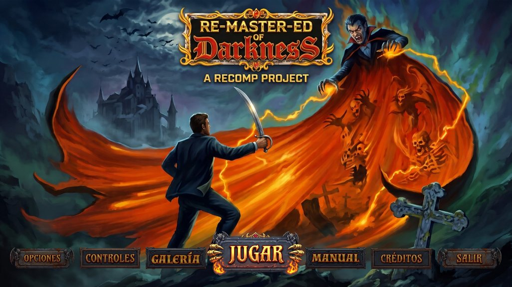
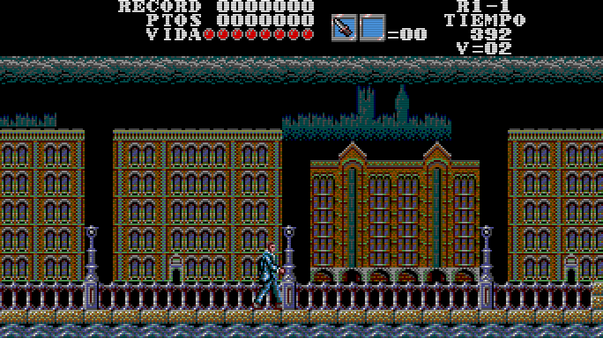

# Re-Master-ed of Darkness

*Master of Darkness* (Sega Master System, 1992) remasterizado para Android: panorámico 16:9 de verdad, en
castellano e ingles, con logros, modos nuevos y controles modernos. Un proyecto de fan hecho por **Juanmote**.

**La app no incluye el juego.** Necesitas tu propia copia de la ROM:
`Master of Darkness (Europe, Brazil) (En).sms` — CRC32 `96FB4D4B`.





## Instalar (Android)

1. Ve a [**Releases**](../../releases/latest) y descarga el `.apk`.
2. Instálalo. La primera vez te pedirá que elijas tu ROM `.sms`: se copia dentro de la app y no vuelve a pedirse.
3. Las versiones nuevas se instalan encima sin perder ajustes, partidas ni logros.
4. Si vienes de una versión anterior a la 1.0.4 (la firma cambió), desinstálala una vez. Antes, en *Jugar › Exportar perfil*,
   guarda tu perfil de logros para importarlo después.

Funciona en móviles y consolas Android (probado en Odin 3 Max y Retroid Pocket Classic), con mando o con
controles táctiles. Está en castellano y en inglés.

## Qué trae

**Imagen**
- **16:9 panorámico real**: los laterales se reconstruyen con el mapa del nivel, y los enemigos viven también ahí.
- También 4:3, 8:7 (tele de tubo) y **formato Game Gear** (ventana que sigue al héroe, con su marcador y bandas negras).
- Filtros: nítido, suave, scanlines, CRT y CRT curvo, que cubren también las bandas vacías. Seis paletas de color
  (las bandas toman el negro de la paleta elegida) y trajes de varios colores para el Dr. Social.
- Pantalla de inicio con siete secciones y arte propio; icono adaptable; la app se llama **Re-Master-ed of Darkness**.

**Juego**
- **Sin ralentizaciones** (o con las originales, si las echas de menos).
- **Texto en castellano**, con traducción propia: introducción, historia, diálogos de los jefes y final.
- Dificultad fácil, normal o difícil; doble salto (seguro junto al techo); escaleras con salto; reaparición de enemigos a tu gusto.
- Pausa al coger objetos: la original, o sin ella.
- Guardar y cargar estado, rebobinar hasta 20 segundos (L2) y acelerar (R2).
- Trucos: invencible, vidas y munición infinitas, subarmas sin límite, elegir arma y ronda.
- «Versión remasterizada» (lo que trae una instalación nueva) y «Volver al juego original», a un botón.
- Auditado y optimizado: emular un fotograma cuesta la mitad y el juego se comporta igual que antes.

**Modos y logros**
- **Modo logros**: 37 logros propios con icono y aviso al desbloquearlos, con las ventajas bloqueadas.
- **Modo Survivor**: todo el juego con una sola vida, en tres dificultades.
- **Boss Rush**: los cinco jefes seguidos contra el reloj. Cada jefe se desbloquea al llegar a él en cualquier partida.
- Perfil de logros exportable e importable.

**Controles**
- Botones configurables (también C y Z de los mandos de seis botones): «Definir botones» pide atacar, saltar y subarma
  seguidos, y atacar puede ser un botón o todos los libres. Vibración ajustable.
- Controles táctiles en tres tamaños, que se esconden solos al conectar un mando.

**Sonido**
- Música original del juego, o la tuya: hasta tres packs de música opcionales
  ([cómo preparar uno](docs/PACK_MUSICA.md)), con prueba de pistas también en el launcher.
- Música del menú original, sintetizada en la app, y sin chasquidos al abrir o cerrar el menú.
- Galería y manual: packs opcionales de imágenes (`.zip` de `.jpg` o `.png`) que se eligen desde la pantalla de inicio.

## Controles

| Acción | Mando | Teclado (PC) |
|---|---|---|
| Moverse | Cruceta o stick izquierdo | Flechas |
| Saltar | A (se puede cambiar) | X, K o Espacio |
| Atacar | Los demás botones (se puede cambiar) | Z o J |
| Subarma | Y (se puede cambiar), o arriba + atacar | Arriba + Z |
| Pausa | START | Intro |
| Menú | SELECT o ATRÁS | Esc o Tab |
| Rebobinar / acelerar | L2 / R2 | Q / E |
| Guardar / cargar estado | Desde el menú | F5 / F8 |

## Preguntas frecuentes

- **¿Dónde consigo la ROM?** Tiene que ser tu propia copia del juego. Este proyecto no la incluye ni la enlaza.
- **Me dice «ROM no reconocida».** El juego arranca con otras versiones, pero las mejoras solo funcionan con la
  ROM europea indicada arriba, sin parches.
- **No oigo la música nueva.** Los packs de música no vienen con la app: cada uno prepara el suyo.

## Compilar

- **Android:** cada cambio en `main` compila y publica el APK con GitHub Actions (`.github/workflows/android.yml`).
- **PC (para probar):** hace falta SDL2.
  ```sh
  cmake -S . -B build -G Ninja -DCMAKE_BUILD_TYPE=Release
  cmake --build build
  ./build/masterofdarkness mod.sms
  ```

Cómo está hecho por dentro: [`docs/NOTAS_TECNICAS.md`](docs/NOTAS_TECNICAS.md). Historial y decisiones del
proyecto: [`ESTADO.md`](ESTADO.md).

## Aviso legal y créditos

- *Master of Darkness* © 1992 SEGA / SIMS. Este es un proyecto de fan, sin ánimo de lucro y sin relación con SEGA.
- El repositorio y el APK **no contienen la ROM ni ningún dato del juego**: gráficos, música y programa salen de
  la copia de cada usuario. La traducción al castellano es un texto propio de este proyecto.
- Recomp y launcher: Juanmote.
- Núcleo Z80: [superzazu/z80](https://github.com/superzazu/z80) (MIT, `third_party/z80/LICENSE`).
- [SDL2](https://www.libsdl.org) (zlib), [stb_image y stb_vorbis](https://github.com/nothings/stb) (dominio público),
  [miniz](https://github.com/richgel999/miniz) (MIT, `third_party/miniz/LICENSE`). Fuente de los menús: DejaVu Sans Mono.

---

**English:** *Master of Darkness* (Sega Master System) remastered for Android — true 16:9 widescreen, no
slowdowns, achievements, Survivor and Boss Rush modes, rewind, save states and configurable controls. The app is
in English and Spanish. It does **not** include the game: you need your own ROM (`Master of Darkness (Europe,
Brazil) (En).sms`, CRC32 `96FB4D4B`). Download the APK from [Releases](../../releases/latest).
