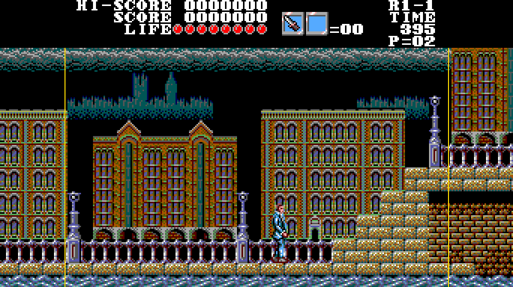

# Master of Darkness Recomp

Port nativo de *Master of Darkness* (Sega Master System, 1992) para Android, con opciones modernas.

**Este repositorio no contiene la ROM.** Cada usuario debe aportar su propia copia:
`Master of Darkness (Europe, Brazil) (En).sms` — CRC32 `96FB4D4B`.

## Instalar (Android)
1. Ve a la sección **Releases** de este repositorio y descarga el último `MasterOfDarkness-*.apk`.
2. Instálalo. La primera vez que lo abras te pedirá que elijas tu ROM `.sms`; se copia dentro de la app y no vuelve a pedirse.
3. Las nuevas versiones se instalan encima de la anterior sin perder ajustes ni estados guardados.

## Controles
| Acción | Mando | Teclado (PC) |
|---|---|---|
| Moverse | Cruceta / stick izquierdo | Flechas |
| Saltar | Botón inferior (A en Xbox) — intercambiable en el menú | X / K / Espacio |
| Atacar | Botón derecho / izquierdo / superior | Z / J |
| Pausa del juego | START | Enter |
| Menú de opciones | SELECT / ATRÁS, o tocar la pantalla | Esc / Tab |

## Opciones del menú
- **Formato**: 16:9 panorámico (los laterales se reconstruyen con el mapa real del nivel), 4:3 con píxel cuadrado o tele de tubo (píxel 8:7).
- **Escalado**: ajustar a pantalla, escala entera o estirar.
- **Filtro**: nítido, nítido suavizado, suave o scanlines.
- Volumen, intercambio de botones, guardar/cargar estado y reiniciar.

## Estado
- v0.1: el juego original se ejecuta en un núcleo propio (CPU Z80 interpretada, vídeo y sonido) con el 16:9 "decorativo".
- v0.2: los enemigos aparecen y se mueven también por los laterales en 16:9 (en 4:3 el juego es idéntico al original).
- Siguiente: recompilación del código a C y 16:9 completo con enemigos en los laterales.

Notas técnicas: `docs/NOTAS_TECNICAS.md`.

## Compilar en PC
Requiere SDL2: `cmake -S . -B build && cmake --build build`, y coloca la ROM como `mod.sms` junto al ejecutable.

## Créditos y licencias
- Port: Juanmote. *Master of Darkness* © SEGA / SIMS 1992; este proyecto no incluye ningún dato del juego.
- Núcleo Z80: [superzazu/z80](https://github.com/superzazu/z80) (MIT). SDL2 (zlib). Fuente de los menús: DejaVu Sans Mono.
